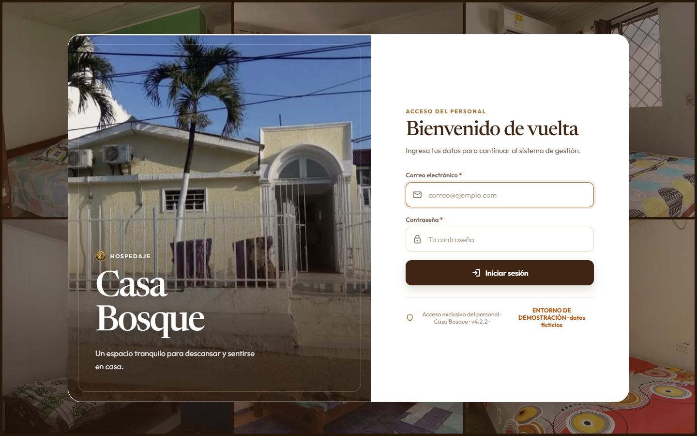
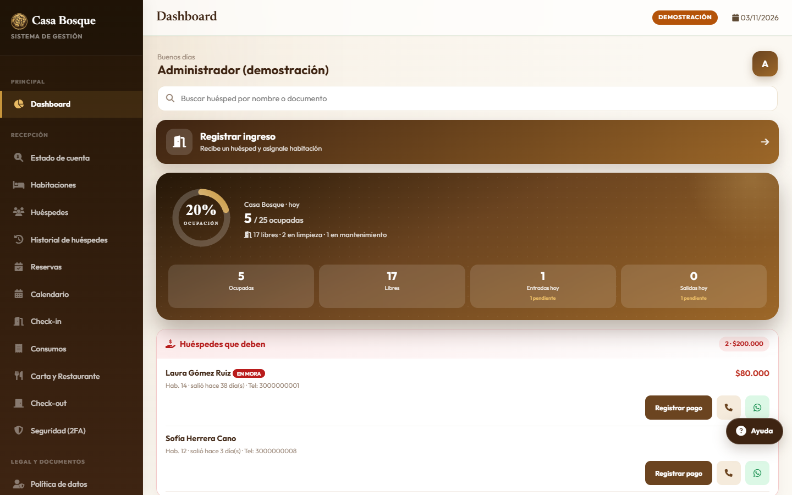
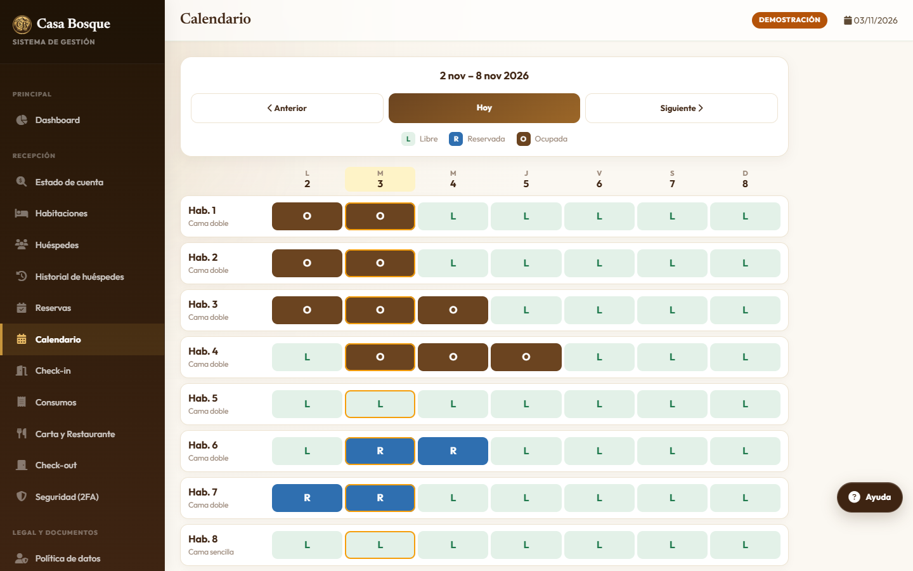
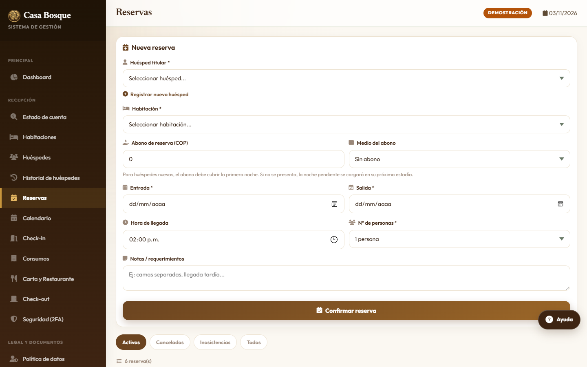
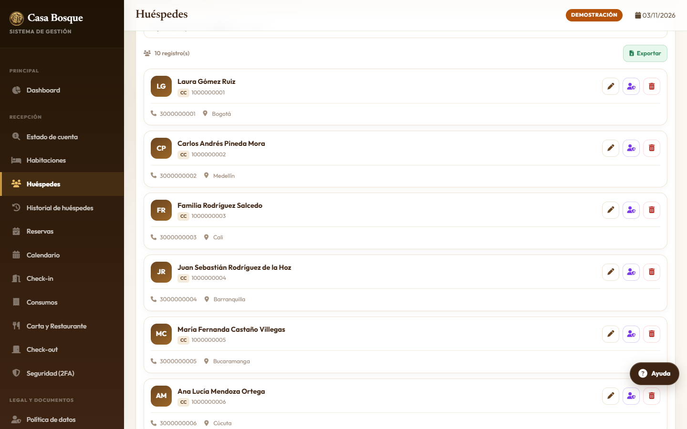
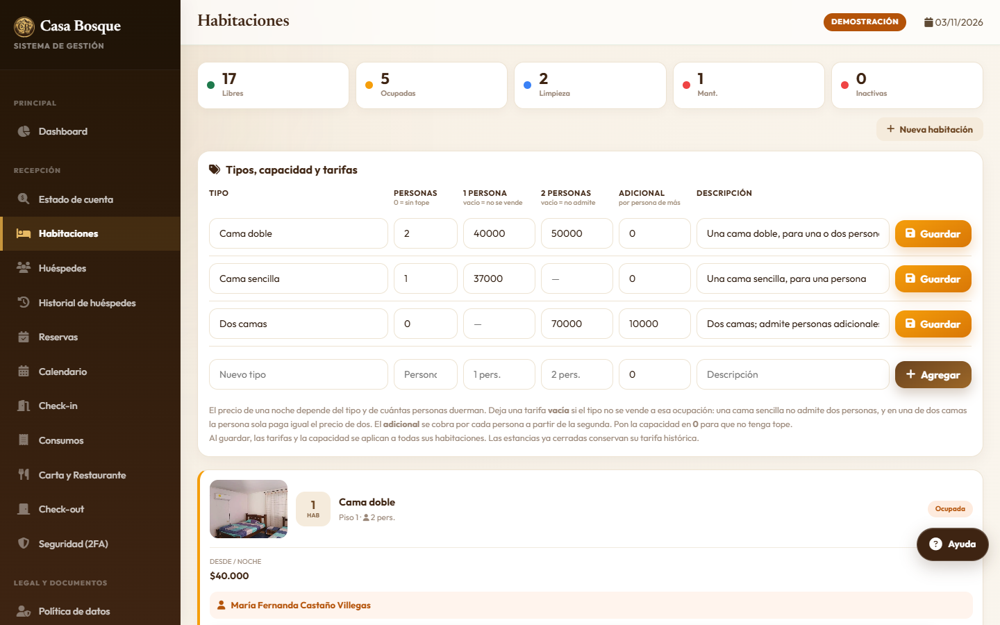
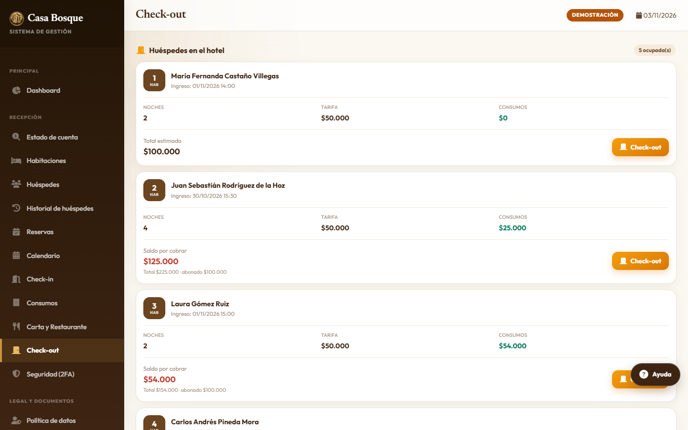
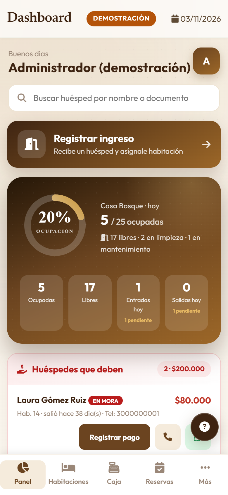
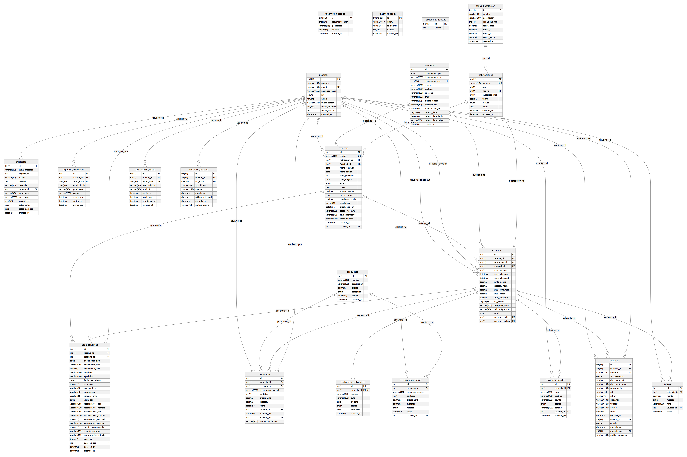

# Casa Bosque — SIGH-CB

**Sistema Integral de Gestión Hotelera** del Hotel Casa Bosque (Cartagena de Indias): huéspedes, reservas, check-in, consumos,
check-out, facturas, caja y auditoría, con dos roles (administrador y recepcionista). PHP 8.3 + MariaDB, sin framework.
Proyecto integrador de las **Unidades Tecnológicas de Santander**. Versión **5.0.0**. Los datos de las capturas son ficticios.

---

## El sistema

| | |
|---|---|
|  **Acceso del personal** |  **Panel:** ocupación del día, entradas y salidas, huéspedes que deben |
|  **Calendario** semanal: libre, reservada y ocupada |  **Reservas** |
|  **Huéspedes** (el documento se guarda cifrado) |  **Habitaciones** y tarifas por ocupación |
|  **Check-out:** cuenta de cada huésped en el hotel |  **En el celular** |

---

## Estructura de carpetas

```
casa-bosque-demo/
├── assets/
│   ├── css/                      estilos
│   ├── js/                       JavaScript (incluye jsPDF para los PDF)
│   ├── img/                      logos y fachada
│   └── habitaciones/             fotos de las habitaciones
├── base-de-datos/
│   ├── 1-casabosque-MariaDB-MySQL.sql
│   ├── 2-diccionario-de-datos.csv
│   └── 3-diagrama-entidad-relacion.png / .svg
├── config/
│   ├── database.php              conexión a la base de datos
│   ├── establecimiento.php       datos del hotel e IVA
│   └── dian.php, retencion.php   facturación electrónica y retención
├── config_privado/               carpeta protegida (no se sirve por la web)
├── docs/capturas/                las imágenes de este documento
├── includes/                     la lógica compartida: tarifas, noches, caja, cifrado,
│                                 claves, sesiones, auditoría, mensajes, disponibilidad…
├── logs/                         carpeta protegida (no se sirve por la web)
├── modules/                      las pantallas
│   ├── recepcion/  huespedes/  reservas/  calendario/  checkin/
│   ├── consumos/  productos/  checkout/  facturacion/  habitaciones/
│   ├── reportes/                 arqueo de caja, ingresos, comprobantes, respaldo
│   ├── usuarios/                 usuarios y seguridad (sesiones, equipos de confianza)
│   ├── auditoria/                registro de acciones, alertas y exportación
│   ├── auth/                     cierre de sesión
│   └── menu.php                  menú del celular
├── sql/
│   └── schema.sql                esquema de producción
│
├── acceso.php, verificar_2fa.php entrada al sistema (contraseña y código de 2 pasos)
├── index.php, dashboard.php      punto de entrada y panel principal
├── manual.html                   manual de usuario por roles
├── asistente_responder.php       asistente de ayuda
├── autorizacion-menor.php        carta de autorización para menores
├── politica-datos.php,
│   politica-menores.php          políticas de tratamiento de datos
├── caido.html, offline.html,
│   404.php, error505.php         páginas de error y de sin conexión
├── sw.js, manifest.json          aplicación instalable en el celular
├── bg-login.jpg, bg-login.webp,
│   favicon.svg, icon-*.png       imágenes del acceso y de la aplicación
└── .htaccess, .env.example,
    .gitignore                    configuración del servidor y ejemplo del .env
```

El `.env` (credenciales y claves de cifrado) **no** está en el repositorio: se guarda fuera de la carpeta pública. [`.env.example`](.env.example) muestra qué variables lleva.

---

## Base de datos

MariaDB / MySQL, **22 tablas**, 30 llaves foráneas y 2 disparadores que vuelven inmutable el registro de auditoría.

| Grupo | Tablas |
|---|---|
| **Hospedaje** | `tipos_habitacion`, `habitaciones`, `huespedes`, `acompanantes`, `reservas`, `estancias` |
| **Dinero** | `consumos`, `productos`, `categorias_producto`, `ventas_mostrador`, `pagos`, `facturas`, `facturas_electronicas`, `secuencias_factura` |
| **Acceso y seguridad** | `usuarios`, `sesiones_activas`, `equipos_confiables`, `intentos_login`, `intentos_huesped`, `auditoria` |

El diagrama de más abajo muestra 21 de las 22 tablas: no incluye `categorias_producto` (las categorías de la carta, desde la versión 5.0.0), que se relaciona con `productos` por su clave.

Archivos en [`base-de-datos/`](base-de-datos):

| Archivo | Qué es |
|---|---|
| `1-casabosque-MariaDB-MySQL.sql` | El esquema, con el catálogo: 3 tipos de habitación, 25 habitaciones y 10 productos |
| `2-diccionario-de-datos.csv` | Cada columna: tipo, si acepta nulo, llave y a qué tabla apunta |
| `3-diagrama-entidad-relacion.png` / `.svg` | El diagrama entidad-relación de abajo |

### Diagrama entidad-relación

Las 21 tablas anteriores a la versión 5.0.0, con sus columnas, `PK` / `FK` / `UK` y las relaciones de las llaves foráneas.



Casi todas las tablas apuntan a `usuarios` (quién hizo cada cosa). El núcleo del modelo:
`tipos_habitacion` 1—N `habitaciones` · `habitaciones` 1—N `reservas` · `huespedes` 1—N `reservas` ·
`reservas` 1—0..1 `estancias` · `estancias` 1—N `consumos`, `pagos` y `facturas`.
